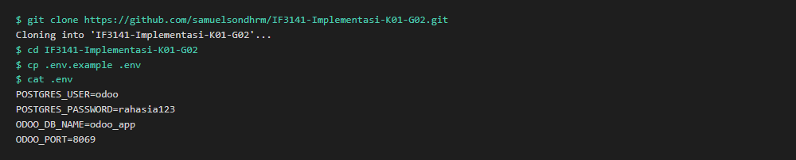
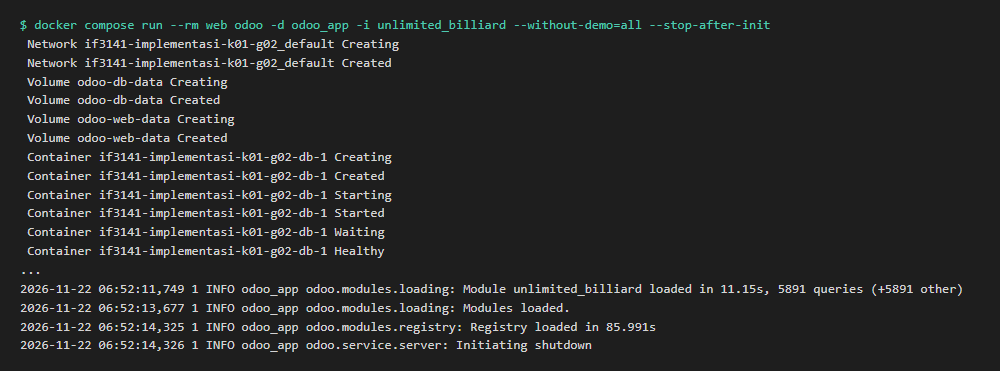
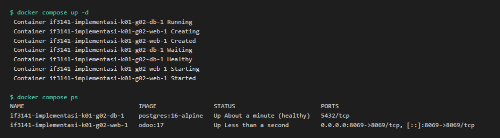
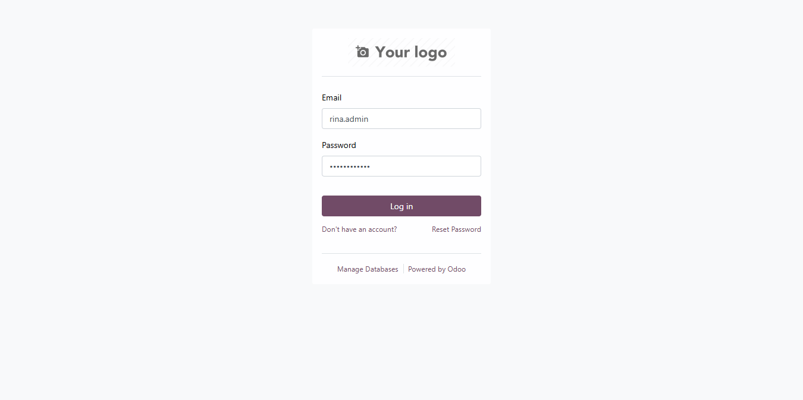
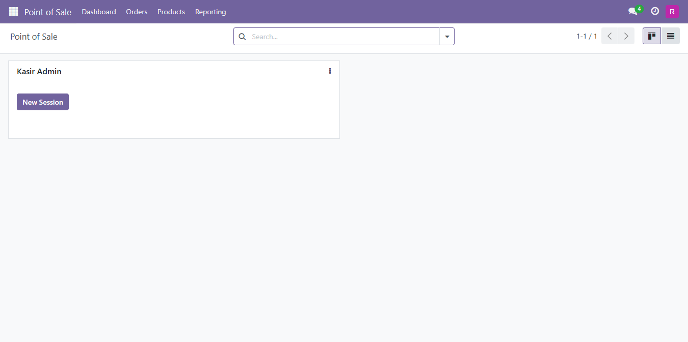

# IF3141-Implementasi-K01-G02

**Sistem Informasi Operasional Terintegrasi berbasis Odoo Community** untuk **Unlimited Billiard & Cafe**.
IF3141 Sistem Informasi · Kelas K01 · Kelompok G02.

## Identitas Kelompok

Kelompok **G02**, kelas **K01**.

| Nama | NIM |
|---|---|
| Samuelson Dharmawan Tanuraharja | 13524001 |
| Nicholas Wise Saragih Sumbayak | 13524037 |
| Syaqina Octavia Rizha | 13524088 |
| Michael James Liman | 13524106 |
| Ega Luthfi Rais | 13524115 |
| Rasyad Satyatma | 13524142 |

## Deskripsi

Unlimited Billiard & Cafe sudah memiliki POS yang mencatat waktu bermain dan pesanan. Namun data POS itu terputus dari stok Kitchen, pembelian, dan rekap kas. Akibatnya Manajer harus merekonsiliasi secara manual sebelum penggajian, stok tidak diketahui secara *real-time*, dan selisih kas tidak bisa ditelusuri ke *shift* tertentu. **Sistem Informasi Operasional Terintegrasi berbasis Odoo Community** (solusi SL-01) menyatukan pencatatan itu dalam satu basis data. Fungsi POS lama (*open table* per menit, tagihan gabungan) dipindahkan ke platform baru, bukan diciptakan dari nol.

Sistem dibangun di atas Odoo 17.0 Community dengan modul standar `point_of_sale`, `pos_restaurant`, `pos_loyalty`, `pos_mrp`, `purchase_stock`, `contacts`, dan `l10n_id`. Pesanan F&B per meja, tiket Kitchen, pemotongan stok sesuai resep, pembelian dengan persetujuan Manajer, rekap kas per *shift*, program poin, dan laporan memakai fitur bawaan yang dikonfigurasi. Kebutuhan yang langsung menjawab akar masalah dan tidak tersedia di Odoo dibuat sebagai satu modul kustom, `custom_addons/unlimited_billiard`, yang juga memuat seluruh data awal dan akun demo. Modul ini berisi:

| Fitur | Model / komponen | FR |
|---|---|---|
| Sesi meja: tombol *Mulai Sesi / Selesai Sesi* di POS, status meja di denah, biaya per menit, tarif Early Time / member dipilih otomatis dan dipecah per segmen jam | `ub.sesi.meja`, `static/src/sesi_meja_button.*`, `static/src/denah_status_meja.*` | FR-08, FR-13 |
| *Stock opname* Kitchen: draf → ajukan → validasi/kembalikan oleh Manajer, % selisih dalam rupiah | `ub.stock.opname`, `ub.stock.opname.line` | FR-04 |
| Serah terima *shift* Kitchen untuk bahan kritis | `ub.serah.terima.shift`, `ub.detail.serah.terima` | FR-05 |
| Keanggotaan 1 bulan (otomatis saat dibayar di POS), *cron* kedaluwarsa, persetujuan data, anonimisasi | `ub.keanggotaan`, ekstensi `res.partner` | FR-12 |
| No. faktur pemasok wajib sebelum *Receipt* divalidasi | ekstensi `stock.picking` | FR-07 |
| Tiket Kitchen disimpan sebagai gambar (printer disimulasikan) | `controllers/kitchen_ticket.py` | FR-02 |
| Konfigurasi: semua PO butuh persetujuan, stok POS dipotong saat pesanan lunas, ubah harga/diskon POS hanya untuk manajer, pecahan uang Rupiah untuk *cash control*, data demo | `data/`, `views/settings_views.xml` | FR-03, FR-07, FR-10, FR-13 |

## Cara Menjalankan

Prasyarat: Docker Desktop (sudah berjalan) dan Git.

1. Clone repo, lalu buat `.env` dan ubah `POSTGRES_PASSWORD` di dalamnya:
   ```bash
   git clone https://github.com/samuelsondhrm/IF3141-Implementasi-K01-G02.git
   cd IF3141-Implementasi-K01-G02
   cp .env.example .env        # Windows: copy .env.example .env
   ```
   Hasil: folder repo terbentuk dan `.env` berisi kredensial database.

   

2. Pasang modul (sekali, ±2 menit). Perintah ini sekaligus menyalakan database:
   ```bash
   docker compose run --rm web odoo -d odoo_app -i unlimited_billiard --without-demo=all --stop-after-init
   ```
   Hasil: log diakhiri `Modules loaded.` dan `Registry loaded`, tanpa baris `ERROR`.

   

3. Jalankan Odoo:
   ```bash
   docker compose up -d
   ```
   Hasil: container `db` (*healthy*) dan `web` berstatus *Up* di port 8069.

   

4. Buka http://localhost:8069 dan masuk dengan salah satu akun di bawah, misalnya `rina.admin` / `unlimited123`.

   

   Hasil: Admin masuk ke **Point of Sale** dan melihat kasir **Kasir Admin**. Tekan *New Session* untuk membuka sesi kas dan denah meja.

   

Langkah 2 harus dijalankan **sebelum** `docker compose up -d`. Container `web` membuat database `odoo_app` kosong begitu menyala, sehingga instalasi yang berjalan bersamaan bisa gagal. Untuk mengulang dari awal dengan data demo yang bersih: `docker compose down -v`, lalu ulangi langkah 2–3.

## Akun Demo

Semua akun memakai kata sandi **`unlimited123`** (hanya untuk lingkungan demo).

| Aktor | Login | Nama | Akses utama |
|---|---|---|---|
| A-01 Admin (siang) | `rina.admin` | Rina Kartika | POS, pelanggan, *Receipt*, draf PO |
| A-01 Admin (malam) | `dimas.admin` | Dimas Pratama | sama dengan Rina |
| A-02 Kitchen (siang) | `ujang.kitchen` | Ujang Suherman | *stock opname*, serah terima, *Replenishment* |
| A-02 Kitchen (malam) | `fajar.kitchen` | Fajar Nugraha | sama dengan Ujang |
| A-03 Manajer Operasional | `bayu.manajer` | Bayu Santoso | validasi *stock opname*, *Approve Order*, ubah harga POS, anonimkan pelanggan, hak akses |
| A-04 Owner | `hendra.owner` | Hendra Wijaya | laporan POS, Inventory, Purchase |
| Akun nonaktif (uji FR-14) | `lina.admin` | Lina Marlina | tidak bisa login |
| Administrator teknis | `admin` | — | kata sandi `admin`, hanya untuk pemeliharaan |

Pelanggan demo: Andi Saputra (member aktif), Sinta Maharani (member kedaluwarsa), Rizky Ramadhan (bukan member), Pelanggan Umum.

## Perintah Lain

| Keperluan | Perintah |
|---|---|
| Lihat log | `docker compose logs -f web` |
| Berhenti (data tetap) | `docker compose down` |
| Berhenti dan **menghapus data** | `docker compose down -v` |
| Upgrade modul setelah `git pull` | `docker compose run --rm web odoo -d odoo_app -u unlimited_billiard --stop-after-init` lalu `docker compose restart web` |
| Jalankan test modul | `docker compose run --rm web odoo -d odoo_test -i unlimited_billiard --test-enable --test-tags /unlimited_billiard --stop-after-init --without-demo=all` |
| Backup / restore database | `scripts/export_db.sh`, `scripts/import_db.sh` (Windows: `.cmd`) |

Catatan:

- Gunakan `docker compose run --rm web odoo ...`, bukan `exec`, karena hanya `run` yang memakai koneksi database dari `.env`.
- Untuk menjalankan test kedua kalinya pada `odoo_test` yang sama, ganti `-i` dengan `-u`. Di Git Bash Windows, awali dengan `MSYS_NO_PATHCONV=1` agar `/unlimited_billiard` tidak diubah menjadi path Windows.

## Batasan Implementasi

- Berjalan lokal di Docker. Rancangan produksi (VPS, M3 TW-05/AR-02) belum di-*deploy*, jadi QR-03 (POS luring) dan QR-04 (kinerja cetak) belum diuji.
- Printer Kitchen disimulasikan: tiket disimpan sebagai gambar di menu **Point of Sale › Orders › Tiket Kitchen**. Alamat printer diset ke `localhost:8069`; bila `ODOO_PORT` diubah, ubah juga *Proxy IP* Printer Kitchen.
- Odoo Community tidak punya peran baca-saja, jadi Owner memakai hak manajer Inventory/Purchase dan dimitigasi lewat SOP + jejak *chatter*.

## Kesimpulan dan Saran

### Kesimpulan

1. **Data operasional tidak lagi terputus.** Pesanan meja, sewa meja, parkir, dan pembayaran tercatat dalam satu POS yang langsung memotong stok bahan sesuai resep saat pesanan lunas. Pembelian, penerimaan barang, dan laporan memakai basis data yang sama, sehingga Manajer tidak perlu merekonsiliasi penjualan dengan pemakaian bahan secara manual (PR-03).
2. **Selisih kas dapat ditelusuri per *shift*.** Setiap sesi kasir mencatat kas awal, kas akhir, dan selisihnya atas nama kasir yang bertugas (FR-10).
3. **Stok Kitchen menjadi *real-time* dan serah terima menjadi baku.** *Stock opname* dengan validasi Manajer, serah terima *shift* untuk bahan kritis, dan peringatan stok minimum yang langsung membuat draf PO menjawab PR-05.
4. **Tarif dan keanggotaan berjalan otomatis.** Sesi meja menghitung biaya per menit dan memilih tarif Early Time atau member sendiri, sehingga promo jam siang dan manfaat member konsisten tanpa ubah harga manual (PE-01).
5. **Hak akses per peran** (Admin, Kitchen, Manajer Operasional, Owner) membatasi tindakan sensitif seperti mengubah harga, memvalidasi *stock opname*, dan menyetujui PO.

Pendekatan *hybrid* (memakai fitur standar Odoo dan hanya mengustom yang menjawab akar masalah) membuat seluruh FR-01 s.d. FR-14 dapat direalisasikan dengan satu modul kustom. Masalah ketergantungan pada Manajer (PR-01) dan *booking*/daftar tunggu (PR-04) berada di luar lingkup sistem.

### Saran

1. *Deploy* ke VPS sesuai rancangan produksi dan uji POS luring (QR-03) serta kinerja cetak (QR-04) di perangkat kasir sebenarnya.
2. Hubungkan printer Kitchen fisik melalui IoT Box atau *proxy* ESC/POS untuk menggantikan tiket yang saat ini disimpan sebagai gambar.
3. Tambahkan peran baca-saja untuk Owner lewat modul kustom (grup + *access rule* baca saja) agar tidak perlu bergantung pada mitigasi SOP.
4. Kembangkan modul *booking* meja dan daftar tunggu (PR-04) sebagai tahap berikutnya, memanfaatkan data sesi meja yang sudah ada.
5. Atur bahasa antarmuka ke Bahasa Indonesia dan format Rupiah tanpa desimal saat *go-live* (sebelum ada transaksi), karena jumlah desimal mata uang tidak bisa dikurangi setelah ada jurnal.

## Troubleshooting

- **Port 8069 terpakai**: ubah `ODOO_PORT` di `.env`, lalu `docker compose up -d`.
- **`variable is missing a value`**: `.env` belum dibuat atau belum diisi.
- **`Failed to initialize database` saat langkah 2**: `docker compose up -d` sempat dijalankan lebih dulu. Jalankan `docker compose down -v`, lalu ulangi dari langkah 2.
- **Setelah `git pull`, Odoo kosong / database hilang**: sejak volume Docker diberi awalan nama folder, clone lama masih menyimpan data di volume `odoo-db-data` dan `odoo-web-data`. Pindahkan sekali saja (ganti `if3141-implementasi-k01-g02` dengan nama folder repo dalam huruf kecil, cek dengan `docker volume ls`; di Git Bash awali tiap perintah dengan `MSYS_NO_PATHCONV=1`):
  ```bash
  docker compose down
  docker run --rm -v odoo-db-data:/lama -v if3141-implementasi-k01-g02_odoo-db-data:/baru postgres:16-alpine sh -c "cp -a /lama/. /baru/"
  docker run --rm -v odoo-web-data:/lama -v if3141-implementasi-k01-g02_odoo-web-data:/baru postgres:16-alpine sh -c "cp -a /lama/. /baru/"
  docker compose up -d
  ```
  Bila data lama tidak diperlukan, cukup ulangi langkah 2–3. Setelah data terverifikasi, volume lama boleh dihapus: `docker volume rm odoo-db-data odoo-web-data`.
- **Modul tidak muncul**: pastikan langkah 3 dijalankan, atau aktifkan Developer Mode lalu **Apps › Update Apps List**.
- **Skrip `.sh` error `\r`**: pastikan file memakai LF (`.gitattributes` sudah mengaturnya; clone ulang bila perlu).
